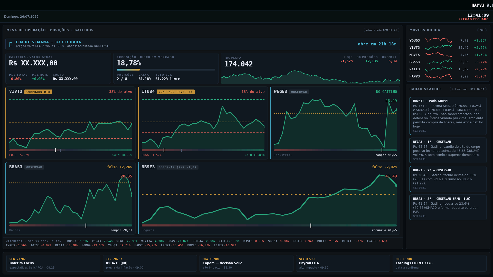

# b3-portfolio-dashboard

A zero-dependency, self-contained 1080p dashboard for a Brazilian (B3) stock portfolio, built for a dedicated TV, kiosk or Home Assistant panel.

  



*Screenshot taken with `MASK_PRIVATE_VALUES` enabled. The dashboard UI is in Brazilian Portuguese.*

## Overview

Broker apps and charting tools show everything at once and need someone to click around. This
dashboard is meant to stay open on a wall screen and show only what requires a decision: portfolio
P&L, exposure against the strategy cap, each open position with its stop/target (OCO) levels, radar
candidates close to their trigger, and the economic calendar. A Python script using only the standard
library pulls quotes from Yahoo Finance and renders one static HTML file from a template: no server,
no `pip install`, no container.

## Features

- Renders a cockpit with portfolio value, total and daily P&L, cost basis, exposure gauge against an 80% cap, cash, and Ibovespa with a 120-session chart plus USD/BRL.
- Draws up to six "trading desk" cards (open positions first, then radar candidates), each with a 30-session chart and stop, target, entry and trigger levels.
- Tracks long and short positions, with P&L signs inverted for shorts and a D+N/10 time-stop badge per position.
- Ranks the full watchlist by 30-day relative strength against the Ibovespa in a compact text strip.
- Computes B3 holidays (fixed dates plus Easter-based Carnival, Good Friday and Corpus Christi) and shows a market-closed banner with a countdown to the next session.
- Builds a 5-event agenda from `events.json` plus computed recurring events (Focus report on Mondays, US payroll on the first Friday).
- Masks every BRL amount with one flag (`MASK_PRIVATE_VALUES`) for screens in shared spaces.
- Optionally pushes the HTML over SSH to Home Assistant's `www/` folder; the page reloads itself every 5 minutes.

## How it works

```
data/acoes.txt         watchlist (B3 tickers)
data/carteira.json     positions (qty, entry, OCO) + capital and cash   [git-ignored]
data/radar.json        optional radar cache / hand-written picks        [git-ignored]
events.json            dated events (Copom, IPCA, earnings)
template.html          layout: HTML/CSS/JS with placeholders
        |
        v
build.py  -->  fetches quotes (Yahoo Finance chart API, no token)
               computes holidays and the agenda
               splices JSON into the template  -->  painel-acoes.html
               (optional) ssh push to Home Assistant
```

- The output HTML is static; the clock and session status run live in JavaScript, quotes change on each build.
- Auto-reload navigates to `?v=<timestamp>` instead of calling `location.reload()`, because Home Assistant serves `/local/` with a 31-day `Cache-Control` and some kiosk browsers ignore forced reloads.
- Guardrails: if more than half of the quotes fail, or any open position has no quote, the build aborts without overwriting the previous dashboard. If the radar source cannot be parsed, the last cached radar is used.
- `check.js` runs the dashboard script in Node against a minimal DOM shim, because a JS error in the template otherwise leaves the screen silently blank.

## Requirements

- Python 3.9+ (standard library only; `zoneinfo` is required)
- Internet access to `query1.finance.yahoo.com`
- Optional: Node.js to run `check.js`
- Optional: SSH key access to a Home Assistant host for publishing
- Optional: systemd (user units) for scheduling

## Quick start

1. Clone the repo and create your portfolio file from the sample:

   ```bash
   git clone https://github.com/cascodigital/b3-portfolio-dashboard
   cd b3-portfolio-dashboard
   cp data/carteira.example.json data/carteira.json
   ```

2. Edit `data/acoes.txt` (one B3 ticker per line, `.SA` suffix optional) and `data/carteira.json`.

3. Build and open the dashboard:

   ```bash
   python3 build.py --no-push
   xdg-open painel-acoes.html
   ```

   The build prints a line such as `OK atualizado QUI 15:12 | 8 tickers | failures: none`.

## Configuration

Environment variables read by `build.py`:

| Variable / key | Required | Default | Description |
|---|---|---|---|
| `PAINEL_DATA_DIR` | No | `./data` | Directory holding `acoes.txt`, `carteira.json` and `radar.json` |
| `RADAR_HTML_FILE` | No | none | Daily analysis HTML to parse into the radar |
| `PAINEL_SSH_DEST` | No | none | SSH destination for the push, e.g. `root@homeassistant`; no push when unset |
| `PAINEL_SSH_PORT` | No | `22` | SSH port |
| `PAINEL_SSH_PATH` | No | `/config/www/painel-acoes.html` | Remote path written via `ssh ... cat >` |

Portfolio file `data/carteira.json` (keys are in Portuguese and are read by the code; see `data/carteira.example.json`):

| Variable / key | Required | Default | Description |
|---|---|---|---|
| `posicoes[]` | Yes | | Open positions; `[]` is supported and renders an empty desk |
| `posicoes[].ticker` | Yes | | B3 ticker without `.SA`; fetched even if not in the watchlist |
| `posicoes[].qtd` | Yes | | Quantity |
| `posicoes[].preco_entrada` | Yes | | Entry price |
| `posicoes[].data_compra` | No | | Entry date (ISO), drives the D+N time-stop badge |
| `posicoes[].lado` | No | `long` | `short` for short sales |
| `posicoes[].stop_loss` / `alvo` | No | | OCO levels (aliases `stop` / `take_profit`; legacy `obs` text "stop R$x / alvo R$y" is also parsed) |
| `capital_operacional` | No | | Operating capital, denominator of the exposure gauge |
| `caixa_operacional` | No | | Cash shown in the cockpit |
| `teto_posicoes` | No | `8` | Denominator of the `N / max` position counter |
| `historico_vendas[]` | No | | Closed trades; stored for future realized-P&L reporting, not displayed yet |

In `template.html`, `MASK_PRIVATE_VALUES` (default `false`) hides all BRL amounts and keeps percentages.

## Usage

**Publish to Home Assistant.** With key-based SSH access:

```bash
export PAINEL_SSH_DEST=root@homeassistant
python3 build.py
```

In Home Assistant, add a `type: panel` view with an `iframe` card pointing to `/local/painel-acoes.html`.

**Schedule with systemd.** `systemd/` contains a user service and timer that run every 15 minutes
during the session (Mon-Fri 10:00-17:45) plus an 18:05 snapshot. The service expects the repo at
`~/painel-acoes`; edit `ExecStart` if it lives elsewhere.

```bash
cp systemd/painel-acoes.* ~/.config/systemd/user/
systemctl --user daemon-reload
systemctl --user enable --now painel-acoes.timer
```

**Radar.** Either write `data/radar.json` by hand or point `RADAR_HTML_FILE` at a daily analysis HTML:

```json
{"generatedAt": "2026-07-26T15:45", "items": [
  {"t": "LREN3", "kind": "buy", "title": "1º — COMPRA", "body": "R$ 15,20 · Alvo +6% · Stop -3%",
   "ref": 15.20, "tp": 16.11, "sl": 14.74},
  {"t": "WEGE3", "kind": "info", "title": "2º — OBSERVAR", "body": "R$ 45,57 · Gatilho: fechar acima de 45,65",
   "ref": 45.57, "tg": 45.65, "td": "up"}
]}
```

`kind` (`buy`, `warn`, `info`) sets the color. Numeric fields create a desk card: `ref` (price at
analysis time), `tg` + `td` (trigger price and direction, `up` for breakout, `down` for pullback),
`sl` / `tp` (stop and target).

**Validate the template** after editing it:

```bash
node check.js painel-acoes.html
```

## Limitations

- The two radar HTML parsers (`parse_radar_v2` and the legacy `parse_radar`) target one specific Portuguese-language e-mail format; adapt them for any other source. Parser failure is silent apart from a stderr line: the radar keeps showing cached data, so watch the "último run" timestamp.
- Quotes come from Yahoo Finance's unofficial chart endpoint, which can change or rate-limit without notice.
- Sector labels are a small hardcoded map in `build.py`; unknown tickers show `B3`.
- The dashboard has no authentication or hardening; it is meant for a private network or an authenticated tunnel.
- UI labels are in Brazilian Portuguese.
- Not investment advice.

## License

MIT — see [LICENSE](LICENSE).
